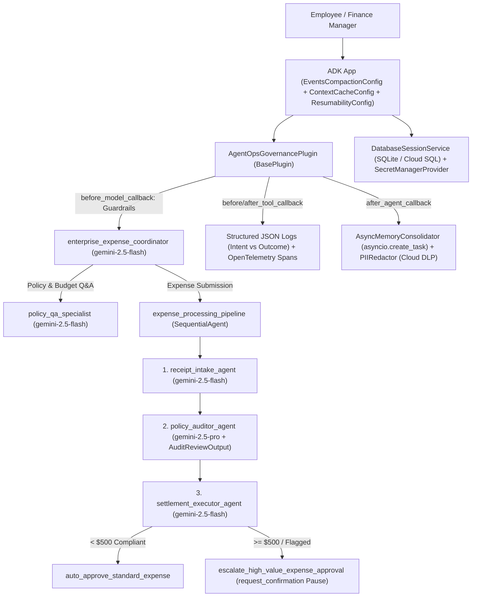

# Enterprise Expense & Policy Approval Multi-Agent (Google ADK)

## Problem & Solution

**Problem:** Corporate finance teams spend hours manually reviewing low-risk employee expense claims while still needing airtight audit controls, PII protection, and human manager sign-off for high-value purchases.

**Solution:** A production-ready **Enterprise Agents** multi-agent system built with **Google Agent Development Kit (ADK)** that:
1. Answers corporate expense policy and department budget questions instantly via a fast **Policy Q&A Specialist** (`gemini-2.5-flash`).
2. Processes submitted expense claims through a deterministic **3-stage Sequential Pipeline** combining fast intake/tool execution (`gemini-2.5-flash`) with deep compliance auditing (`gemini-2.5-pro` with strict Pydantic structured outputs).
3. Automatically approves compliant claims **strictly under $500 USD**, while enforcing a hard **Human-in-the-Loop (HITL)** pause (`tool_context.request_confirmation`) requiring explicit Finance Manager sign-off for any claim **>= $500 USD** or flagged with risk anomalies.
4. Enforces enterprise **AgentOps** controls across every turn: prompt-injection guardrails, self-evaluation output checks, Cloud DLP PII scrubbing, structured JSON logging with Intent vs. Outcome capture, OpenTelemetry distributed tracing, persistent SQLite/Cloud SQL session state, ADK event compaction, non-blocking async memory consolidation, Secret Manager integration, Terraform IaC, and GitHub Actions CI/CD + ADK golden evaluations.

---

## Architecture



---

## AgentOps Code Review Matrix Mapping (19 / 19 Criteria)

| Category | Criterion | Implementation Location |
| --- | --- | --- |
| **1. Tool & Interface Design** | Comprehensive Tool Docstrings | `expense_agent/tools.py` (Google-style Purpose, Args, Returns on all 5 tools) |
| | Descriptive Naming | `lookup_corporate_expense_policy`, `fetch_department_budget_balance`, `validate_expense_receipt_policy`, `auto_approve_standard_expense`, `escalate_high_value_expense_approval` |
| | Explicit JSON Schemas | `expense_agent/schemas.py` (strict Pydantic v2 `BaseModel` with `extra="forbid"`) + `output_schema=AuditReviewOutput` in `agent.py` |
| | Guided Error Handling | `StructuredToolError` with actionable `recovery_instructions` in `expense_agent/tools.py` |
| **2. Context & Memory** | Robust System Instructions | `expense_agent/prompts.py` (constitutions per agent with thresholds, protocols & hard constraints) |
| | History Compaction | `EventsCompactionConfig` + `ContextCacheConfig` on ADK `App` in `expense_agent/app.py` |
| | Persistent Session State | `DatabaseSessionService` + `PersistentExpenseLedger` (SQLite / Cloud SQL) in `expense_agent/memory_store.py` |
| | Async Memory Operations | `AsyncMemoryConsolidator` (`asyncio.create_task` + `asyncio.to_thread`) triggered in `after_agent_callback` |
| **3. Orchestration & Logic** | Multi-Agent Patterns | `LlmAgent` Coordinator + `SequentialAgent` 3-stage pipeline in `expense_agent/agent.py` |
| | Strategic Model Routing | `select_model_for_task()` routing `gemini-2.5-flash` vs. `gemini-2.5-pro` in `expense_agent/agent.py` |
| | Guardrails & Policy Plugins | `AgentOpsGovernancePlugin(BasePlugin)` prompt-injection & self-eval checks in `expense_agent/plugins.py` |
| | Human-in-the-Loop Hooks | `tool_context.request_confirmation(...)` + `ResumabilityConfig(is_resumable=True)` in `tools.py` & `app.py` |
| **4. Observability & Tracing** | Structured JSON Logging | `StructuredJsonFormatter` & `log_structured_event()` in `expense_agent/observability.py` (zero `print()`) |
| | Intent vs. Outcome Capture | `tool_intent` (`before_tool_callback`) paired with `tool_outcome` (`after_tool_callback`) in `expense_agent/plugins.py` |
| | Distributed Tracing | OpenTelemetry `TracerProvider`, `CloudTraceSpanExporter`, and `start_linked_span()` in `expense_agent/observability.py` |
| | PII Redaction | `PIIRedactor` (Google Cloud DLP `deidentify_content` + regex fallback) in `expense_agent/pii_redactor.py` |
| **5. Infrastructure & CI/CD** | Automated Evaluation Suites | `evals/expense_agent.evalset.json`, `evals/eval_config.json`, `tests/test_agent_ops.py`, `.github/workflows/ci.yml` |
| | Infrastructure as Code | `terraform/main.tf`, `terraform/variables.tf`, `terraform/outputs.tf` + `agents-cli` / `adk deploy` guide below |
| | Secure Secret Management | `SecretManagerProvider` (`google-cloud-secret-manager`) in `expense_agent/secrets.py` + `.env.example` & `.gitignore` |

---

## Local Quickstart & Testing

```bash
# 1. Create virtual environment and install dependencies
python3 -m venv .venv
source .venv/bin/activate
pip install -r requirements.txt

# 2. Configure local environment (never commit .env)
cp .env.example .env

# 3. Run automated regression & AgentOps tests
pytest -v

# 4. Run ADK golden evaluation suite (requires GEMINI_API_KEY in .env)
adk eval expense_agent evals/expense_agent.evalset.json \
  --config_file_path=evals/eval_config.json

# 5. Launch interactive ADK Web UI locally
adk web .
```

---

## Deployment (Terraform IaC, Agents CLI & ADK Deploy)

### 1. Provision Cloud Infrastructure with Terraform
```bash
cd terraform
cp terraform.tfvars.example terraform.tfvars
# Populate project_id and container_image in terraform.tfvars
terraform init
terraform plan
terraform apply
```

### 2. Deploy to Vertex AI Agent Engine / Agent Runtime via Agents CLI or ADK CLI
Using the **Google Cloud Agents CLI (`agents-cli`)** or **ADK CLI (`adk deploy`)**:

```bash
# Option A: Deploy to Vertex AI Agent Engine via ADK CLI
adk deploy agent_engine \
  --project="${GCP_PROJECT_ID}" \
  --region="us-central1" \
  --display_name="Enterprise Expense Approval Agent" \
  expense_agent

# Option B: Deploy to Agent Runtime via Agents CLI
agents-cli deploy \
  --project="${GCP_PROJECT_ID}" \
  --region="us-central1" \
  --source="./expense_agent"
```

### 3. Populate Runtime Secrets in Secret Manager (Never in Code)
```bash
echo -n "${GEMINI_API_KEY}" | gcloud secrets versions add gemini-api-key --data-file=-
echo -n "${SESSION_DB_URL}" | gcloud secrets versions add session-db-url --data-file=-
```
